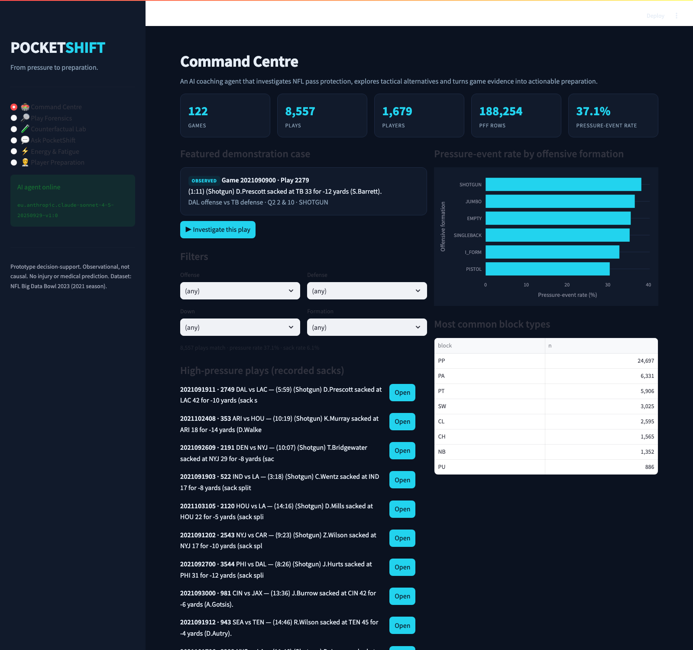
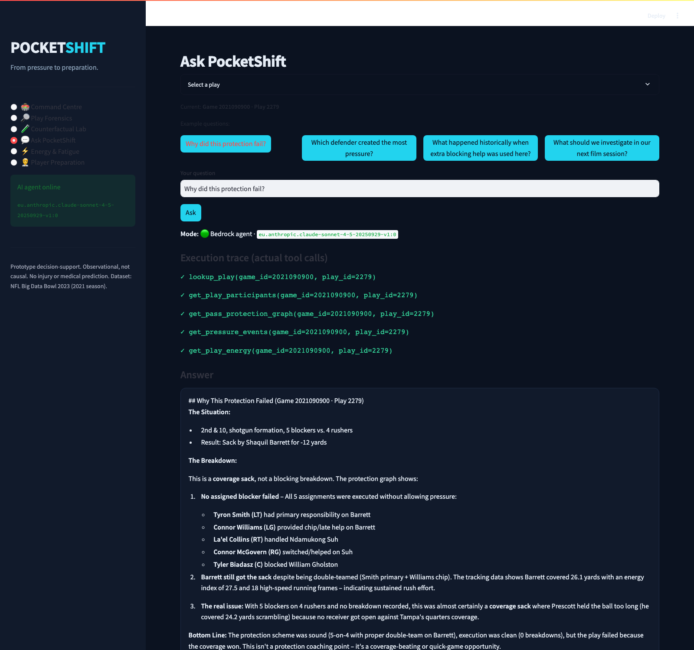
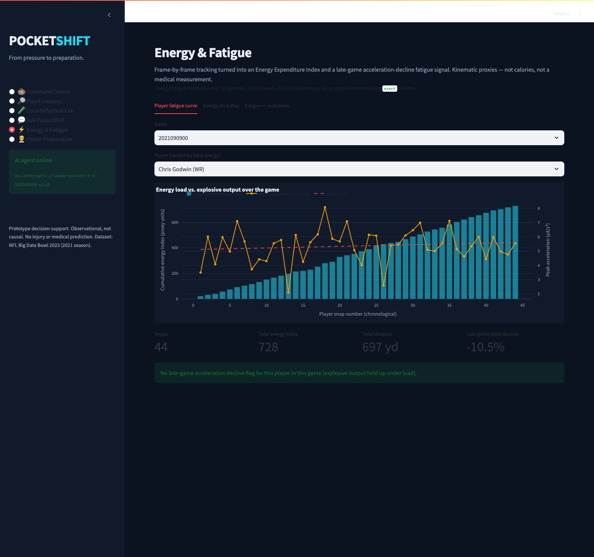
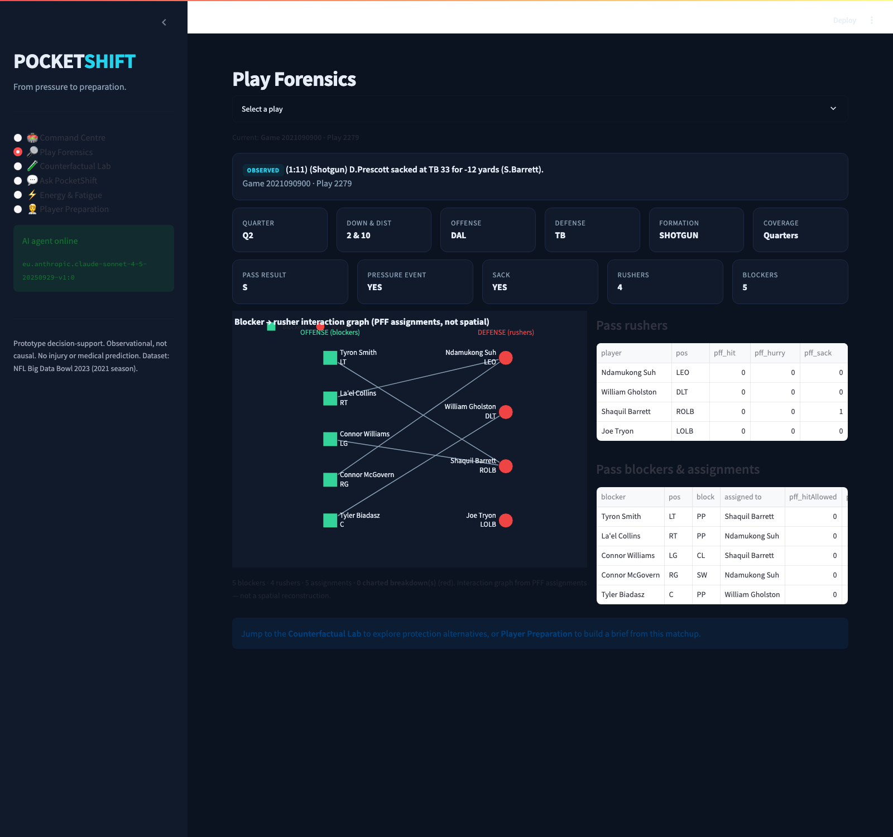

# PocketShift AI 🏈

**The Counterfactual Protection & Player Preparation Agent**

*From pressure to preparation. Don't just explain why the pocket collapsed —
explore what could have changed, and turn the lesson into a preparation plan.*

Built for the NFL × UCL Centre for Digital Innovation × AWS Big Data Bowl Hackathon,
on the NFL Big Data Bowl 2023 regional dataset (2021 season, Weeks 1–8).



---

## 60-second summary

**What it is.** PocketShift AI turns an NFL pass-protection failure into a coaching
decision. It reconstructs who blocked whom, retrieves comparable historical plays,
estimates a protection alternative with real sample sizes and honest uncertainty,
measures each player's in-play energy expenditure and fatigue from frame-by-frame
tracking, and hands the lesson to the performance staff as a review-gated brief.

**What it reveals.** Whether a sack was a protection breakdown or a coverage sack;
what comparable plays did under an alternative; who loses explosive output late in a
game; and that pressure rises sharply with play energy load (≈17% → 37% → 59% across
effort tertiles).

**Who would use it.** Offensive-line and pass-rush coaches, analysts, and the
performance / strength-and-conditioning staff who own refuelling and rotation.

**How it's built.** A six-screen Streamlit workstation over a tested Python
analytics core, with a **live Amazon Bedrock agent** (`Claude Sonnet 4.5`) that
chooses and executes real analytical tools — and a deterministic reviewer that can
veto any answer.

### Side-quest — Energy & Fatigue (the invented metric)

The **Energy Expenditure Index (EEI)** and a **late-game acceleration-decline
fatigue flag** are built from the frame-by-frame tracking data (speed, acceleration,
distance), gated at the snap via the `event` column. They implement the NFL
practitioner's recommendation to track energy expenditure and fatigue — the loss of
high-speed acceleration linked to less successful plays. EEI is a kinematic effort
proxy, not calories and not a medical measurement, and the live agent can query it
on demand (see the Ask PocketShift tool trace below).

### How this maps to the judging rubric

| Dimension | Where to look |
|---|---|
| **Football insight** | Coverage-sack vs. protection-breakdown diagnosis; selection bias in extra-protection; fatigue → late-game explosive decline; energy ↔ pressure link. |
| **Technical execution** | Strict composite joins, leakage-guarded GroupKFold model, bootstrap CIs, live Bedrock tool-use loop, deterministic evidence reviewer, 36 passing tests. |
| **Communication** | Six-screen workstation, evidence-typed answers, labelled axes/units, inline screenshots, 3-minute demo script. |
| **Originality** | An **invented metric** (Energy Expenditure Index + fatigue flag) and a counterfactual "what-if" lab, fused with a tool-using AI agent. |

## Problem

Every NFL pass play generates a mountain of information. Coaching staff still
spend scarce time working out *what happened*, *what to investigate changing*,
and *how to turn that into preparation*. Existing analytics describe pressure and
sacks. They rarely help a coach reason about a plausible alternative with honest
evidence, or hand the lesson to the performance staff.

## Solution

PocketShift is an interactive, agentic decision-intelligence tool with six screens:

1. **Command Centre** — dataset coverage, filters, high-pressure plays, featured demo.
2. **Play Forensics** — observed play facts + an interactive blocker→rusher graph.
3. **Counterfactual Lab** — observed vs. a plausible alternative, estimated from
   matched historical plays with sample size and bootstrap uncertainty.
4. **Ask PocketShift** — a live AI agent (Bedrock Claude Sonnet 4.5) that selects
   and executes real analytical tools, grounds every claim in retrieved rows, and
   shows its execution trace.
5. **Energy & Fatigue** — tracking-derived Energy Expenditure Index, per-game
   fatigue curves (energy load vs. explosive output), per-play energy breakdown,
   and a fatigue↔outcome link. *(Side-quest metric.)*
6. **Player Preparation** — a performance-staff preparation brief built from dataset
   facts, human-review-gated, with no medical/injury inference.

## Screens

**Live Bedrock agent — real tool trace, grounded answer.** Asked "why did this
protection fail?", Claude Sonnet 4.5 chose five tools (including the tracking energy
tool) and diagnosed a coverage sack, citing the exact play.



**Energy & Fatigue (invented metric).** Cumulative energy load rises while the
peak-acceleration trend line falls — the late-game fatigue signature.



**Play Forensics — blocker→rusher interaction graph** (PFF assignments, not a
spatial reconstruction).



## Why it matters to NFL teams

It compresses film-room triage: pinpoints where a protection broke, shows what
comparable real plays did under an alternative, quantifies the (uncertain)
historical association, and produces a coach-reviewable preparation brief — in one
flow, grounded in evidence a coach can click through to.

## Why it is different

- **Counterfactual, not just descriptive.** It compares matched historical plays
  and reports a difference *with uncertainty and sample size*, never a fabricated
  "what-if" number.
- **Honest about causation.** Blocking choices are not randomised; comparisons are
  explicitly observational, and selection bias is surfaced, not hidden.
- **Genuine tool-using agent.** The Bedrock Converse loop lets the model choose
  tools; the app executes real analytical functions and validates the result.
- **Evidence-typed everything.** Every number is tagged observed / historical /
  model / hypothetical. A deterministic reviewer can veto any answer.
- **Invented metric from tracking.** The Energy Expenditure Index and fatigue flag
  quantify in-play workload and late-game explosive decline — something not
  measured in the scouting data — directly from frame-by-frame tracking.
- **Tactics → preparation bridge.** A `PerformanceContextAdapter` turns play
  intelligence into a performance-staff workflow, gated behind human review.

## Data

NFL Big Data Bowl 2023 (2021 season). Measured from the workspace:

| File | Rows |
|---|---:|
| games.csv | 122 |
| plays.csv | 8,557 |
| players.csv | 1,679 |
| pffScoutingData.csv | 188,254 |

PFF role distribution (normalised): coverage 57,765 · pass_block 46,057 ·
pass_route 39,513 · pass_rush 36,362 · pass 8,557. The **122 frame-by-frame
tracking files** (10 Hz: position, speed, acceleration, orientation, `event`) power
the Energy & Fatigue metric; the rest of the app runs without them and never
fabricates coordinates.

**The raw dataset is not redistributed here** (gitignored for licensing). See
[`data/README.md`](data/README.md) for one-command download/setup. Join keys are
always composite — `(gameId, playId)`, never `playId` alone.

## Methodology

- **Pressure-event label (play level):** a play is a pressure event when any
  `Pass Rush` row has `pff_hit`, `pff_hurry` or `pff_sack` = 1. This is a
  **scouting-derived proxy** for recorded pressure involvement, not an official
  Next Gen Stats pressure probability. Observed pressure-event rate: **37.1%**.
- **Counterfactual comparison:** filter real plays to a comparable context
  (down / distance / formation), split into the modified arm (e.g. 6+ blockers)
  vs. baseline, and compare the outcome rate. Report both rates, the difference,
  n per arm, and a bootstrap 95% CI. Below 30 plays per arm → explicit
  *"not enough comparable historical evidence"* warning.
- **Pre-snap pressure model:** `pressure_event` from pre-snap/context features
  only (down, distance, quarter, personnel, formation, box, field position,
  play-action, score margin). Validation uses **GroupKFold by `gameId`** so plays
  from one game never straddle the split. A leakage guard asserts no post-snap
  column enters the feature matrix.
- **Energy Expenditure Index (EEI) & fatigue (tracking, side-quest):** from the
  frame-by-frame tracking data (10 Hz `s`, `a`, `dis`), gated at the snap via the
  `event` column. Per play, `EEI = Σ distance + 0.17·Σ(|a|·distance)·dt` — a
  metabolic-power-style proxy rewarding distance and penalising explosive
  accel/decel. Per player per game we accumulate load and compare early-vs-late
  peak acceleration; a **≥10% late-game acceleration decline under high load**
  flags fatigue — the "loss of high-speed acceleration linked to less successful
  plays" a performance coach watches for. EEI is a kinematic **proxy in effort
  units, not calories and not a physiological measurement.**
  Observed link: pressure-event rate rises monotonically across play energy-load
  tertiles (≈17% → 37% → 59%), connecting effort to outcome (association, not cause).

### AI agent architecture

Five specialised responsibilities over a shared, real tool registry:

- **Agent 1 — Play Forensics:** `lookup_play`, `get_play_participants`,
  `get_pass_protection_graph`, `get_player_history`, `get_pressure_events`.
- **Agent 2 — Historical Comparison:** `find_similar_plays`,
  `calculate_empirical_pressure_rate`, `compare_protection_configurations`
  (deterministic calculation, never LLM-generated statistics).
- **Agent 3 — Counterfactual Investigator:** `estimate_historical_alternative`
  with support checks and uncertainty.
- **Agent 4 — Performance Preparation:** `get_position_demands`,
  `summarize_observed_exposure`, `build_preparation_brief`,
  `get_player_fatigue`, `get_play_energy` (tracking-derived energy & fatigue).
- **Agent 5 — Evidence & Quality Reviewer (deterministic, authoritative):**
  verifies cited (gameId, playId) exist, blocks affirmative medical/injury claims,
  and rejects any trace entry that doesn't map to an executed tool. **The LLM can
  never override a deterministic validation failure.**

Orchestration uses the **Amazon Bedrock Converse API with tool use**: the model
selects tools, the app validates arguments and executes the real functions,
returns structured `toolResult`s, and the final answer is reviewed before display.
If Bedrock is unavailable, the app falls back to a deterministic answer that runs
the same real tools and clearly flags *"AI agent unavailable."*

## How to run

```bash
# 1. Create a virtualenv and install deps
python3 -m venv .venv
source .venv/bin/activate
pip install -r requirements.txt

# 2. Add the dataset (see data/README.md) into data/

# 3. Profile + build processed tables (optional; the app also builds on first run)
python profile_data.py

# 4. Launch
streamlit run app.py
```

Open the featured play (Game 2021090900 · Play 2279: Dak Prescott sacked by
Shaquil Barrett) and click **Investigate this play**.

### The Bedrock agent (live)

Credentials are discovered from the environment, a local AWS profile, or an
attached role — **never put keys in code or committed config**. The app auto-picks
the first accessible model from a candidate list; in the hackathon account that
resolves to `eu.anthropic.claude-sonnet-4-5-20250929-v1:0` in `eu-central-1`.

Region defaults to `AWS_REGION` → `AWS_DEFAULT_REGION` → `eu-central-1`. Verify
access and override the model if you like:

```bash
aws bedrock list-foundation-models --region eu-central-1
# optional overrides (copy .env.example to .env)
export AWS_REGION=eu-central-1
export POCKETSHIFT_BEDROCK_MODEL_ID=eu.anthropic.claude-sonnet-4-5-20250929-v1:0
```

If no model is accessible the app degrades gracefully to deterministic answers
that still run the same real tools and clearly show *"AI agent unavailable."*

Run tests:

```bash
pytest                                   # 36 tests (+1 live-Bedrock test, opt-in)
POCKETSHIFT_ENABLE_LIVE_BEDROCK=1 pytest tests/test_agents.py::test_live_bedrock_tool_loop_when_available
```

## Results and limitations

**Pre-snap pressure model** (out-of-fold, GroupKFold by gameId, n = 8,557,
positive prevalence 0.371):

| Model | ROC-AUC | Brier | Base-rate Brier |
|---|---:|---:|---:|
| Logistic regression (isotonic-calibrated) | 0.576 | 0.2300 | 0.2334 |
| HistGradientBoosting (isotonic-calibrated) | 0.566 | 0.2307 | 0.2334 |

**Honest read:** pre-snap context has only modest power to predict recorded
pressure (AUC ~0.57, a small Brier improvement over the base rate). That is
expected — pressure depends heavily on post-snap execution the model cannot see —
and we report it rather than conceal it. The model is a calibrated context prior,
not a pressure oracle.

**Live agent example (featured play):** asked "why did this protection fail?", the
Bedrock Claude Sonnet 4.5 agent autonomously called `lookup_play`,
`get_play_participants`, `get_pass_protection_graph`, `get_pressure_events` and
`get_play_energy`, then concluded it was a **coverage sack** (5 blockers on 4
rushers, zero charted breakdowns, Barrett double-teamed by Smith + a Williams
chip), citing the tracking energy figures it fetched. The deterministic reviewer
passed it (valid source, no overclaim).

**Counterfactual example (featured play's context — 2nd & long, Shotgun):**
"keep an extra blocker in" shows a *higher* pressure-event rate (42.5%, n=228) than
standard protection (33.9%, n=888). This is almost certainly **selection bias** —
teams keep extra blockers in precisely when they already expect pressure — and the
app says so. It is an association in observational data, not a causal effect.

**Limitations:**
- Pressure label is a scouting-derived proxy, not official NGS pressure.
- All counterfactuals are observational; blocking choices are not randomised.
- No tracking geometry is used in the core workflow; the matchup graph is an
  interaction network, not a spatial reconstruction.
- The preparation brief is a prototype decision-support bridge, not a validated
  injury-prevention or medical system. Workload = observed play involvement, a
  labelled proxy. No physiological, injury, or medical state is inferred.
- The Energy Expenditure Index is a kinematic proxy in arbitrary effort units, not
  calories or a validated metabolic measurement. The fatigue flag is a descriptive
  within-game acceleration-decline signal under load, not a clinical or
  injury-risk assessment. The energy/fatigue tables are built over a bounded game
  subset by default for demo speed (`profile_data.py --tracking --max-games=N`,
  or all 122 games by omitting the cap).

## Originality / competition compliance

- All code, docs, tests and visuals in this repo were created during the event.
- No claim of official NFL endorsement, medical validation, injury prediction, or
  live NFL data.
- No secrets committed (`.env` is gitignored). The raw dataset is not
  redistributed; setup instructions are provided instead.

## Technologies used

Python 3.11+ · Streamlit · Plotly · DuckDB · pandas / NumPy · scikit-learn ·
NetworkX · boto3 (Amazon Bedrock Converse API) · pytest.

## License & data

Application code: MIT (see [`LICENSE`](LICENSE)). The NFL Big Data Bowl dataset is
**not** redistributed here; it is governed by the competition's own terms. See
[`data/README.md`](data/README.md) to download and set it up.

## Future work

- Optional tracking-powered spatial view (enabled only when valid tracking CSVs
  are present).
- Propensity / matching refinements and richer confounder control.
- Managed Bedrock embeddings for retrieval; hosted demo deployment.
- Deeper position-specific preparation templates reviewed by performance staff.
- **Environmental context** (temperature, altitude, precipitation) was raised by
  the practitioner as valuable for refuelling. It is **not in this dataset**, so
  it is deliberately not fabricated; a future version would join free public
  weather/venue data (e.g. via nflverse game metadata) to the energy curves to
  contextualise fatigue by conditions.
- Combination/"assist" outcome analysis: the per-play energy breakdown already
  surfaces assist players (pulling blockers, looping rushers); a next step is to
  score which blocker/assist combinations yield the best protection outcomes.

## Project layout

```
app.py                 Streamlit app (6 screens)
profile_data.py        Reproducible profiling → outputs/data_profile.md
                       (--tracking builds the energy/fatigue tables)
capture_screens.py     Screenshot helper
LICENSE                MIT (application code only)
src/                   config, ingestion, validation, features, matchup_graph,
                       scenarios, modelling, retrieval, evidence, agents,
                       bedrock_client, performance_adapter, visualizations,
                       tracking (energy & fatigue)
tests/                 36 tests (joins, pressure labels, leakage, scenarios,
                       evidence reviewer, agents, tracking fatigue, smoke)
                       + 1 opt-in live-Bedrock test
.kiro/                 specs/pocketshift (requirements, design, tasks) + steering
outputs/               data_profile.md, 6 screenshots, charts
```

## Three-minute demo

See [`DEMO.md`](DEMO.md) for the exact 3-minute live-demo script and 1-minute pitch.
